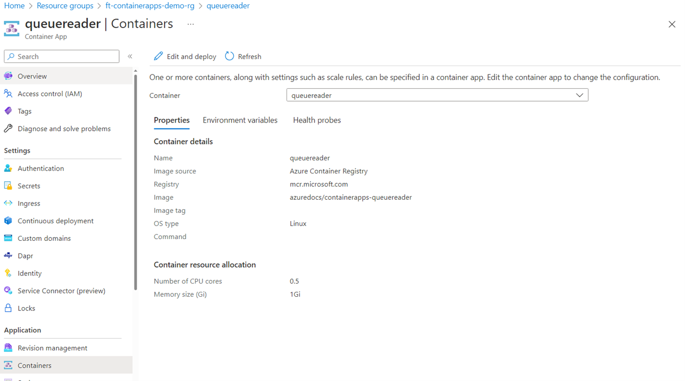
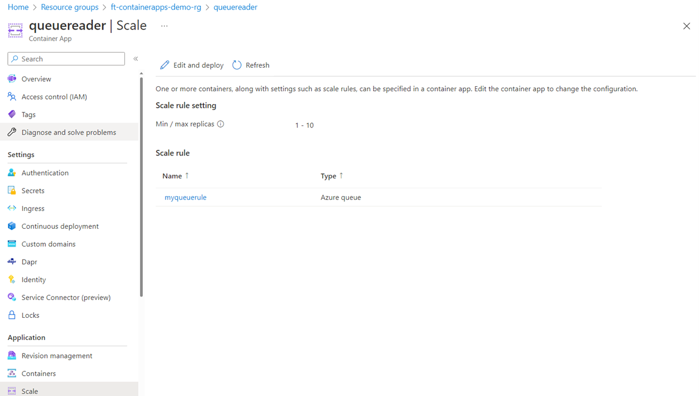
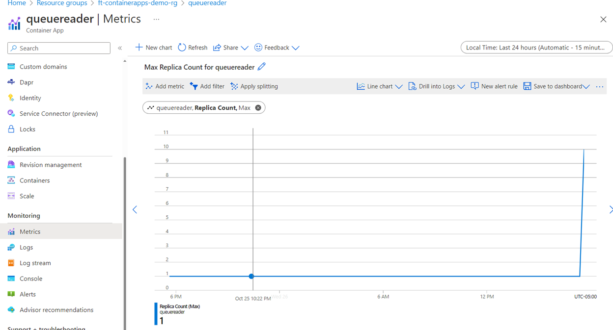
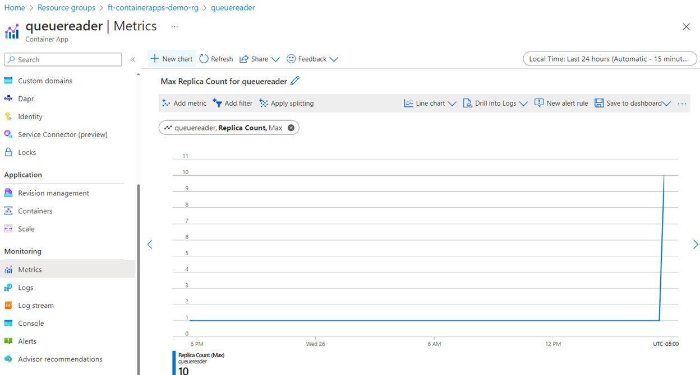

# Scale Azure Container Apps Using KEDA Integration

**Author:** [faismustafa](https://techcommunity.microsoft.com/users/faismustafa/1092385)  
**Originally published:** November 15, 2022  
**Source:** [Microsoft Community Hub](https://techcommunity.microsoft.com/blog/fasttrackforazureblog/scale-azure-container-apps-using-keda-integration/3674861)

In order to set up this KEDA integration, below are the steps you will accomplish as you go through this blog:

1. Create a storage account and retrieve and save the connection string, this will be used in a later step. Create a queue called ‘test-queue’ in the storage account.
2. Use the C# code below that will allow you to hydrate a queue in the storage account with messages. You may alter the number of messages in the for loop as you see fit, it need not be 350, that is just an example number used here.
3. The ARM template that you will use to deploy the queue reader container that will be deployed to Azure Container Apps. This queue reader container has code that reads messages from a specified storage account queue.
4. Finally, the CLI is included that you will use to reference the ARM template and create the Container App.

Source code used to load messages in the storage account is included and is written in C#. You may use this code to load messages in the storage account queue. A container with code to read messages is deployed via the ARM template included below. This ARM template includes the scaling criteria that is used by KEDA scaled objects already deployed on the Azure Container Apps underlying infrastructure (AKS Clusters provisioned).

You can create a simple console .NET Core application. Following is the Main program with the relevant using statements that you will compile:

```csharp
using System;
using MyStorageSamples;
using System.Threading.Tasks;

using Azure.Storage.Queues;
using Azure.Storage.Queues.Models;
using System.Configuration;

namespace MyStorageSamples
{
    class Program
    {
        static async Task Main(string[] args)
        {
            // TO DO: Move these values to KeyVault. Add to GitHub, and also remove credential values prior to the push to repo.
            try
            {
                string connectionString = ConfigurationManager.AppSettings["ConnectionString"];
                string queueName = ConfigurationManager.AppSettings["QueueName"];

                Console.WriteLine("Processing Message for Azure Storage Queue ...");
                Console.WriteLine("Start ...");
                QueueClient queueClient = new QueueClient(connectionString, queueName);

                for (int i = 3; i <= 350; i++)
                {
                    if (args.Length > 0)
                    {
                        string value = String.Join(" ", args);
                        await StorageSamples.InsertMessageAsync(queueClient, value + i);
                        Console.WriteLine($"Sent: {value + i}");
                    }
                    else
                    {
                        string value = await StorageSamples.RetrieveNextMessageAsync(queueClient);
                        Console.WriteLine($"Received: {value + i}");
                    }
                }
                Console.WriteLine("Completed. Message dropped in Queue OK!");

                Console.Write("Finished - Press Enter...");
                Console.ReadLine();
            }
            catch (Exception exc)
            {
                throw exc;
            }
        }
    }
}

public static async Task InsertMessageAsync(QueueClient theQueue, string newMessage)
{
            if (null != await theQueue.CreateIfNotExistsAsync())
            {
                Console.WriteLine("The queue was created.");
            }
            await theQueue.SendMessageAsync(newMessage);
}
```

InsertMessageAsynch is the utility method that inserts the messages in the storage account queue.

In your App.config file replace the value of the connection string with the one for your storage account.

```xml
<?xml version="1.0" encoding="utf-8" ?>
<configuration>
    <appSettings>
      <add key="countoffiles" value="7" />
      <add key="logfilelocation" value="abc.txt" />
      <add key="ConnectionString" value=" YOUR_STORAGE_ACCOUNT_CONNECTION_STRING" />     
      <add key="QueueName" value="test-queue" />
    </appSettings>
</configuration>
```

Next, we create a JSON file called ScaleWithKedaStorageAccountQueue.json and copy the contents of the ARM template below:

```json
{
    "$schema": "https://schema.management.azure.com/schemas/2019-08-01/deploymentTemplate.json#",
    "contentVersion": "1.0.0.0",
    "parameters": {
        "location": {
            "defaultValue": "canadacentral",
            "type": "String"
        },
        "environment_name": {
            "defaultValue": "",
            "type": "String"
        },
        "queueconnection": {
            "defaultValue": "",
            "type": "String"
        }
    },
    "variables": {},
    "resources": [
    {
        "name": "queuereader",
        "type": "Microsoft.App/containerApps",
        "apiVersion": "2022-03-01",
        "kind": "containerapp",
        "location": "[parameters('location')]",
        "properties": {
            "managedEnvironmentId": "[resourceId('Microsoft.App/managedEnvironments', parameters('environment_name'))]",
            "configuration": {
                "activeRevisionsMode": "single",
                "secrets": [
                {
                    "name": "queueconnection",
                    "value": "[parameters('queueconnection')]"
                }]
            },
            "template": {
                "containers": [
                    {
                        "image": "mcr.microsoft.com/azuredocs/containerapps-queuereader",
                        "name": "queuereader",
                        "env": [
                            {
                                "name": "QueueName",
                                "value": "myqueue"
                            },
                            {
                                "name": "QueueConnectionString",
                                "secretRef": "queueconnection"
                            }
                        ]
                    }
                ],
                "scale": {
                    "minReplicas": 1,
                    "maxReplicas": 10,
                    "rules": [
                        {
                            "name": "myqueuerule",
                            "azureQueue": {
                                "queueName": "test-queue",
                                "queueLength": 10,
                                "auth": [
                                    {
                                        "secretRef": "queueconnection",
                                        "triggerParameter": "connection"
                                    }
                                ]
                            }
                        }
                    ]
                }
            }
        }
    }]
}
```

Following CLI is used to deploy the Container Apps. Execute the CLI commands in the same directory where you have created the ARM JSON template

(ScaleWithKedaStorageAccountQueue.json)

```bash
# Register Microsoft.Web
az provider register --namespace Microsoft.App
RESOURCE_GROUP="YOUR_RESOURCE_GROUP_NAME"
LOCATION="canadacentral"
LOG_ANALYTICS_WORKSPACE="YOUR_LOG_ANALYTICS_WORKSPACE_NAME"
CONTAINERAPPS_ENVIRONMENT="YOUR_CONTAINER_APP_ENV_NAME" 

az group create \
  --name $RESOURCE_GROUP \
  --location "$LOCATION"

# Create the environment
az monitor log-analytics workspace create \
  --resource-group $RESOURCE_GROUP \
  --workspace-name $LOG_ANALYTICS_WORKSPACE

# Get the Client_ID and CLIENT_SECRET, run each separately and wait for it to complete
LOG_ANALYTICS_WORKSPACE_CLIENT_ID=`az monitor log-analytics workspace show --query customerId -g $RESOURCE_GROUP -n $LOG_ANALYTICS_WORKSPACE --out tsv`
LOG_ANALYTICS_WORKSPACE_CLIENT_SECRET=`az monitor log-analytics workspace get-shared-keys --query primarySharedKey -g $RESOURCE_GROUP -n $LOG_ANALYTICS_WORKSPACE --out tsv`

# Create the environment in which container app will be deployed
az containerapp env create \
  --name $CONTAINERAPPS_ENVIRONMENT \
  --resource-group $RESOURCE_GROUP \
  --logs-workspace-id $LOG_ANALYTICS_WORKSPACE_CLIENT_ID \
  --logs-workspace-key $LOG_ANALYTICS_WORKSPACE_CLIENT_SECRET \
  --location "$LOCATION"

QUEUE_CONNECTION_STRING="YOUR_STORAGE_ACCOUNT_CONNECTION_STRING"	
# Create the Queue Reader App
az deployment group create --resource-group "$RESOURCE_GROUP" \
  --template-file ./ScaleWithKedaStorageAccountQueue.json \
  --parameters \
    environment_name="$CONTAINERAPPS_ENVIRONMENT" \
    queueconnection="$QUEUE_CONNECTION_STRING" \
    location="$LOCATION"
```

Once deployed, the queue reader app is now created.





From the metrics screen, select Replica Count and the initial Replica Count is 1.



Now run the C# console application and let the messages be populated in the queue. The queue reader container is quite fast in processing the messages. You can view the messages in the queue from the Azure Portal. Allow a few minutes for telemetry to update, you will see the Replica Count increase to support the background processing of the messages, in this case the max is set to 10. The queue reader application reads and deletes the messages from the storage queue that you created.



Once all messages in the queue are processed, there is a cooling off period, and the replicas will eventually go back to 1.
